# Sound-Control_STM32
基于STM32的声控LED交互系统项目
# 基于STM32的声控交互系统

## github使用声明
我之所以想使用GitHub这个网站，一是为了方便直观地展示我的嵌入式项目的学习过程，二是我觉得很多东西他学习了但过会儿时间就会遗忘，所以记录下自己的学习过程我觉得非常重要，他不仅可以帮助我回忆起当初学习的内容，也能记录下我学习过程中的踩过的坑以及自己在闯过难关时的宝贵总结。

## 项目简介
我独立完成了一个基于STM32单片机的声控系统。通过麦克风采集声音，经过算法处理后，可以可靠地控制LED灯。这个项目让我深入学习了嵌入式开发的全流程。

## 硬件清单
- 主控芯片：STM32F103C8T6最小系统板
- 声音传感器：模拟输出驻极体麦克风模块
- 输出设备：LED灯、电阻
- 辅助工具：USB转TTL串口模块（用于调试）、杜邦线、面包板

## 功能展示
1.  **基础功能**：声音触发LED开关。
2.  **算法升级**：采用软件滤波，提高了在嘈杂环境下的识别准确性。
3.  **效果演示**：哔哩哔哩https://b23.tv/UO9EE2F

## 核心代码与算法
这里我重点解决了**环境噪声干扰**的问题。
1. 移动平均滤波算法

我编写了一个滤波函数，采用滑动窗口平均，有效抑制 ADC 采样值的抖动。

```c
// 滑动平均滤波函数（窗口长度 10）
#define FILTER_LEN 10

uint16_t AD_GetFiltered(void) {
    static uint16_t buffer[FILTER_LEN] = {0};
    static uint8_t index = 0;
    uint32_t sum = 0;

    // 将新采样值存入当前 index 位置
    buffer[index] = AD_GetValue();
    // index 循环 0 ~ FILTER_LEN-1
    index = (index + 1) % FILTER_LEN;

    // 累加所有历史数据
    for (int i = 0; i < FILTER_LEN; i++) {
        sum += buffer[i];
    }
    // 返回平均值
    return sum / FILTER_LEN;
}
```
2. 双阈值防抖策略

为了兼顾快速响应与平稳熄灭，我采用双阈值 + 计数防抖的方案：

```c
// 亮灯条件：原始值连续 3 次超过高阈值
if (raw > threshold_on) {
    stable_cnt++;
    if (stable_cnt >= 3) {
        led_state = 1;
        stable_cnt = 3;
    }
}
// 灭灯条件：滤波值连续 3 次低于低阈值
else if (filt < threshold_off) {
    if (stable_cnt > 0) stable_cnt--;
    if (stable_cnt == 0) {
        led_state = 0;
    }
}
```

作用：

· raw（原始值）反应快，用于快速亮灯
· filt（滤波值）稳定平滑，用于平稳灭灯
· 计数防抖过滤单次噪声（如拍桌子），连续 3 次才改变状态

---

3. 自适应阈值

为了让系统适应不同环境音量，我加入了环境底噪自动校准：

```c
// 初始化：采样 20 次取平均作为环境底噪
uint16_t base_noise = 0;
for (int i = 0; i < 20; i++) {
    base_noise += AD_GetFiltered();
    Delay_ms(10);
}
base_noise /= 20;
threshold_on = base_noise * 2 + 50;   // 亮灯阈值
threshold_off = base_noise + 20;       // 灭灯阈值

// 每隔 30 秒重新校准
static uint32_t adapt_timer = 0;
if (++adapt_timer >= 600) {
    // 重新采样，更新阈值
    adapt_timer = 0;
}
```

---

4. 条件编译控制调试

为保证实时性，用 DEBUG_ENABLE 控制串口打印的开关：

```c
#define DEBUG_ENABLE 0   // 调试时改为 1

#if DEBUG_ENABLE
    Serial_Init();
    Serial_SendString("Start\r\n");
    // 每 2 秒打印一次 Raw、Filt、State
#endif
```

调试时开启打印，正常运行时完全关闭，不影响主循环响应速度。

---

开发日志（学习记录）
这是我的项目成长日记，记录了所有关键问题和解决方法。

2026年3月8日：项目启动

目标：搭建开发环境，点亮第一颗LED。

问题：程序下载后LED没反应。

解决：检查发现GPIO口初始化函数中，时钟使能语句写错了位置。纠正后成功点亮。

重温了以前关于学习使用stm32库函数的知识，再次学习了怎么调动库函数。

硬件连接：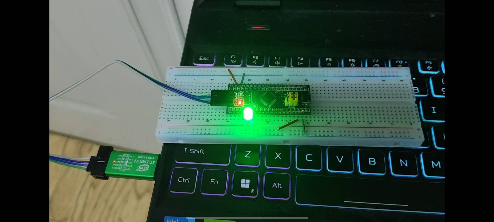

这是我总结了在点亮led灯过程中以及后续会常用的关于gpio的库函数：

```c
void RCC_AHBPeriphClockCmd(uint32_t RCC_AHBPeriph, FunctionalState NewState);
void RCC_APB2PeriphClockCmd(uint32_t RCC_APB2Periph, FunctionalState NewState);
void RCC_APB1PeriphClockCmd(uint32_t RCC_APB1Periph, FunctionalState NewState);

void GPIO_DeInit(GPIO_TypeDef* GPIOx);  // 复位
void GPIO_AFIODeInit(void);  //  复位
void GPIO_Init(GPIO_TypeDef* GPIOx, GPIO_InitTypeDef* GPIO_InitStruct);
//用结构体的参数来初始化gpio口
void GPIO_StructInit(GPIO_InitTypeDef* GPIO_InitStruct);
//把结构体变量赋予一个默认值
uint8_t GPIO_ReadInputDataBit(GPIO_TypeDef* GPIOx, uint16_t GPIO_Pin);
 //读取输入数据寄存器某一个端口的输入值
uint16_t GPIO_ReadInputData(GPIO_TypeDef* GPIOx);
//读取整个输入数据寄存器
uint8_t GPIO_ReadOutputDataBit(GPIO_TypeDef* GPIOx, uint16_t GPIO_Pin);
//读取输出数据寄存器的 某一个位
uint16_t GPIO_ReadOutputData(GPIO_TypeDef* GPIOx);
//读取整个输出数据寄存器
//（4个读取函数）
void GPIO_SetBits(GPIO_TypeDef* GPIOx, uint16_t GPIO_Pin);//把指定端口 设置为高电平
void GPIO_ResetBits(GPIO_TypeDef* GPIOx, uint16_t GPIO_Pin);//把指定端口 设置为低电平
void GPIO_WriteBit(GPIO_TypeDef* GPIOx, uint16_t GPIO_Pin, BitAction BitVal);
void GPIO_Write(GPIO_TypeDef* GPIOx, uint16_t PortVal);
//（4个写入函数）

//关于GPIO_Mode有：
{ GPIO_Mode_AIN = 0x0,  //模拟输入 
  GPIO_Mode_IN_FLOATING = 0x04,  //浮空输入
  GPIO_Mode_IPD = 0x28, // 下拉
  GPIO_Mode_IPU = 0x48,  //上拉
  GPIO_Mode_Out_OD = 0x14, //开漏输出    低电平具有驱动能力
  GPIO_Mode_Out_PP = 0x10,//推挽输出      点灯使用    高低电平均有驱动能力 
  GPIO_Mode_AF_OD = 0x1C,//复用开漏
  GPIO_Mode_AF_PP = 0x18，//复用推挽
}GPIOMode_TypeDef;

//常用led初始化 代码：
void LED_Init(void)
{
RCC_APB2PeriphClockCmd(RCC_APB2Periph_GPIOA,ENABLE);
GPIO_InitTypeDef GPIO_InitStructure;
GPIO_InitStructure.GPIO_Mode=GPIO_Mode_Out_PP;
GPIO_InitStructure.GPIO_Pin=GPIO_Pin_1 | GPIO_Pin_2;
GPIO_InitStructure.GPIO_Speed=GPIO_Speed_50MHz;
 GPIO_Init(GPIOA,&GPIO_InitStructure);
GPIO_SetBits(GPIOA, GPIO_Pin_1 | GPIO_Pin_2);//设置PA1和PA2引脚为高电平
}
```
2026年3月9日：重温学习按键控制的知识

目标：搭建开发环境，通过使用按键控制灯的亮灭，学习如何封装函数

困难：运行代码时总是报错，但是在仔细检查我写的每一个代码都无误

解决：新手小白犯的这种低级错误，就是每在一个xxx.c文件写一个函数就忘记去xxx.h文件里声明可以使用

硬件连接：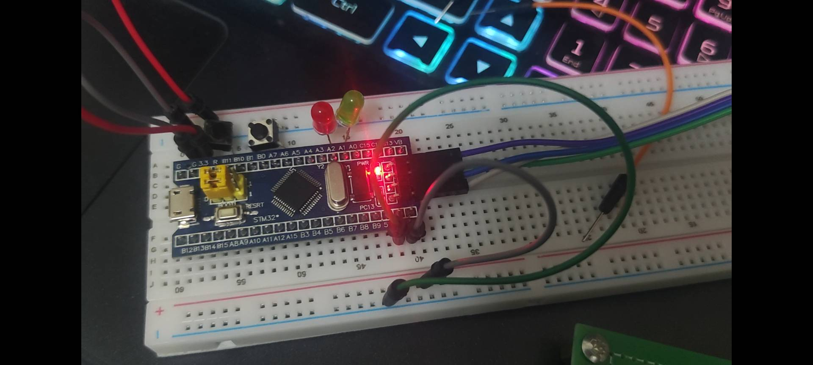

同样，我总结出了常会用到的库函数：

```c
//按键初始化
void Key_Init(void)
{
	RCC_APB2PeriphClockCmd(RCC_APB2Periph_GPIOB, ENABLE);		//开启GPIOB的时钟
	/GPIO初始化/
	GPIO_InitTypeDef GPIO_InitStructure;
	GPIO_InitStructure.GPIO_Mode = GPIO_Mode_IPU;
	GPIO_InitStructure.GPIO_Pin = GPIO_Pin_1 | GPIO_Pin_11;
	GPIO_InitStructure.GPIO_Speed = GPIO_Speed_50MHz;
	GPIO_Init(GPIOB, &GPIO_InitStructure);		//将PB1和PB11引脚初始化为上拉输入
}
uint8_t Key_GetNum(void)        //用于返回按键键码
{
	uint8_t KeyNum = 0;		//定义变量，默认键码值为0
	if (GPIO_ReadInputDataBit(GPIOB, GPIO_Pin_1) == 0)  
        //读PB1输入寄存器的状态，如果为0，则代表按键1按下
	{
		Delay_ms(20);                       //延时消抖
		while (GPIO_ReadInputDataBit(GPIOB, GPIO_Pin_1) == 0);	
               //等待按键松手
		Delay_ms(20);			//延时消抖
		KeyNum = 1;				//置键码为1
	}
                return KeyNum;			
               //返回键码值，如果没有按键按下，所有if都不成立，则键码为默认值0
}
	
led.c设置：
void LED1_ON(void)
{
	GPIO_ResetBits(GPIOA, GPIO_Pin_1);
}
void LED1_OFF(void)
{
	GPIO_SetBits(GPIOA, GPIO_Pin_1);
}
void LED1_Turn(void)
{
if(GPIO_ReadOutputDataBit(GPIOA,GPIO_Pin_1)==0)
     {
	GPIO_SetBits(GPIOA,GPIO_Pin_1);
      }
else
     {
	GPIO_ResetBits(GPIOA,GPIO_Pin_1);
      }
}
main.c 运用
int main(void)
{
	uint8_t KeyNum;
	LED_Init();//直接调用完成LED初始化
	Key_Init();
while (1)
 {
  KeyNum= Key_GetNum();
		if(KeyNum==1)
		{
			LED1_Turn();
	}
		if(KeyNum==2)
		{
			LED1_Turn();
	}
   }
}
```
2026年3月10日至3月14日：重温adc的知识

在课余时间，通过江协科技 STM32 教程，大致了解了adc原理与配置，并重新学习了ADC 单次转换模式，理解了采样时间、数据对齐、软件触发等关键配置。

以下是我根据视频总结出adc.c会常用的库函数

```c
//adc初始化函数：
rcc库函数 void RCC_ADCCLKConfig(uint32_t RCC_PCLK2); //用于配置adcclk分频器

void ADC_DeInit(ADC_TypeDef* ADCx);    //恢复缺省配置
void ADC_Init(ADC_TypeDef* ADCx, ADC_InitTypeDef* ADC_InitStruct);//init初始化
void ADC_StructInit(ADC_InitTypeDef* ADC_InitStruct);//结构体初始化

对adc的一些基本功能和规则组的配置
{
void ADC_Cmd(ADC_TypeDef* ADCx, FunctionalState NewState);//给adc上电
void ADC_DMACmd(ADC_TypeDef* ADCx, FunctionalState NewState);
//开启dma输出信号
void ADC_ITConfig(ADC_TypeDef* ADCx, uint16_t ADC_IT, FunctionalState NewState);//中断输出控制
void ADC_ResetCalibration(ADC_TypeDef* ADCx);//复位校准
FlagStatus ADC_GetResetCalibrationStatus(ADC_TypeDef* ADCx);//获取复位校准 状态
void ADC_StartCalibration(ADC_TypeDef* ADCx);//开始校准
FlagStatus ADC_GetCalibrationStatus(ADC_TypeDef* ADCx);//获取开始校准状态
void ADC_SoftwareStartConvCmd(ADC_TypeDef* ADCx, FunctionalState NewState);//软件触发的函数
FlagStatus ADC_GetSoftwareStartConvStatus(ADC_TypeDef* ADCx);//获取软件开始转换状态

  //配置间断模式的两个函数
  {
void ADC_DiscModeChannelCountConfig(ADC_TypeDef* ADCx, uint8_t Number);//每隔几个通道间断一次
void ADC_DiscModeCmd(ADC_TypeDef* ADCx, FunctionalState NewState);
//是不是启用间断模式
   }
void ADC_RegularChannelConfig(ADC_TypeDef* ADCx, uint8_t ADC_Channel, uint8_t Rank, uint8_t ADC_SampleTime);//adc——规则组通道配置    （重要）
第一个参数 ADCx，第二个ADC_Channel指定通道，第三个Rank序列几的位置，第四个SampleTIime指定通道的采样时间
void ADC_ExternalTrigConvCmd(ADC_TypeDef* ADCx, FunctionalState NewState);//adc_外部触发转换控制（是否允许外部触发转换）
uint16_t ADC_GetConversionValue(ADC_TypeDef* ADCx);//adc_获取转换值
（重要）获取ad转换的数据寄存器，读取转换结果 需要用到这个函数
uint32_t ADC_GetDualModeConversionValue(void);//adc_获取双模式转换值（双adc模式读取转换结果的函数）


}
//对adc注入组进行配置

{
void ADC_AutoInjectedConvCmd(ADC_TypeDef* ADCx, FunctionalState NewState);
void ADC_InjectedDiscModeCmd(ADC_TypeDef* ADCx, FunctionalState NewState);
void ADC_ExternalTrigInjectedConvConfig(ADC_TypeDef* ADCx, uint32_t ADC_ExternalTrigInjecConv);
void ADC_ExternalTrigInjectedConvCmd(ADC_TypeDef* ADCx, FunctionalState NewState);
void ADC_SoftwareStartInjectedConvCmd(ADC_TypeDef* ADCx, FunctionalState NewState);
FlagStatus ADC_GetSoftwareStartInjectedConvCmdStatus(ADC_TypeDef* ADCx);
void ADC_InjectedChannelConfig(ADC_TypeDef* ADCx, uint8_t ADC_Channel, uint8_t Rank, uint8_t ADC_SampleTime);
void ADC_InjectedSequencerLengthConfig(ADC_TypeDef* ADCx, uint8_t Length);
void ADC_SetInjectedOffset(ADC_TypeDef* ADCx, uint8_t ADC_InjectedChannel, uint16_t Offset);
uint16_t ADC_GetInjectedConversionValue(ADC_TypeDef* ADCx, uint8_t ADC_InjectedChannel);


}

//对模拟看门狗进行配置

{
void ADC_AnalogWatchdogCmd(ADC_TypeDef* ADCx, uint32_t ADC_AnalogWatchdog);//是否启动模拟看门狗
void ADC_AnalogWatchdogThresholdsConfig(ADC_TypeDef* ADCx, uint16_t HighThreshold, uint16_t LowThreshold);//配置高低阈值
void ADC_AnalogWatchdogSingleChannelConfig(ADC_TypeDef* ADCx, uint8_t ADC_Channel);//配置看门的通道

}
void ADC_TempSensorVrefintCmd(FunctionalState NewState);//adc_温度传感器,内部参考电压控制
FlagStatus ADC_GetFlagStatus(ADC_TypeDef* ADCx, uint8_t ADC_FLAG);//获取标志位状态
void ADC_ClearFlag(ADC_TypeDef* ADCx, uint8_t ADC_FLAG);//清除标志位
ITStatus ADC_GetITStatus(ADC_TypeDef* ADCx, uint16_t ADC_IT);//获取中断状态
void ADC_ClearITPendingBit(ADC_TypeDef* ADCx, uint16_t ADC_IT);//清除中断挂起位


```
2026年3月15日至3月18日:声控基础实现

一.在 STM32F103 上配置 ADC1 通道 1（PA1），成功读取麦克风模块的模拟输出电压,通过调试器观察adc_value的变化，掌握了用硬件调试定位问题的方法 

二.将 ADC 值与设定的阈值比较，实现了基础声控逻辑： 

1.声音超过阈值时 LED 点亮  

2.安静时 LED 熄灭

代码实现：
```c
//主函数main
int main(void)
{
    LED_Init();       
    AD_Init();        

    uint16_t adc_value;
    uint16_t threshold = 100; 
    uint8_t stable_cnt = 0;

    while(1)
    {
        adc_value = AD_GetValue();
       

  
        if(adc_value > threshold)
        {
            stable_cnt++;
            if(stable_cnt >= 3)
            {
                LED1_ON();
                stable_cnt = 3;
            }
        }
        else
        {
            stable_cnt--;
            if(stable_cnt <= 0)
            {
                LED1_OFF();
                stable_cnt = 0;
            }
        }
        
        Delay_ms(50);
    }
}
```

硬件连接：
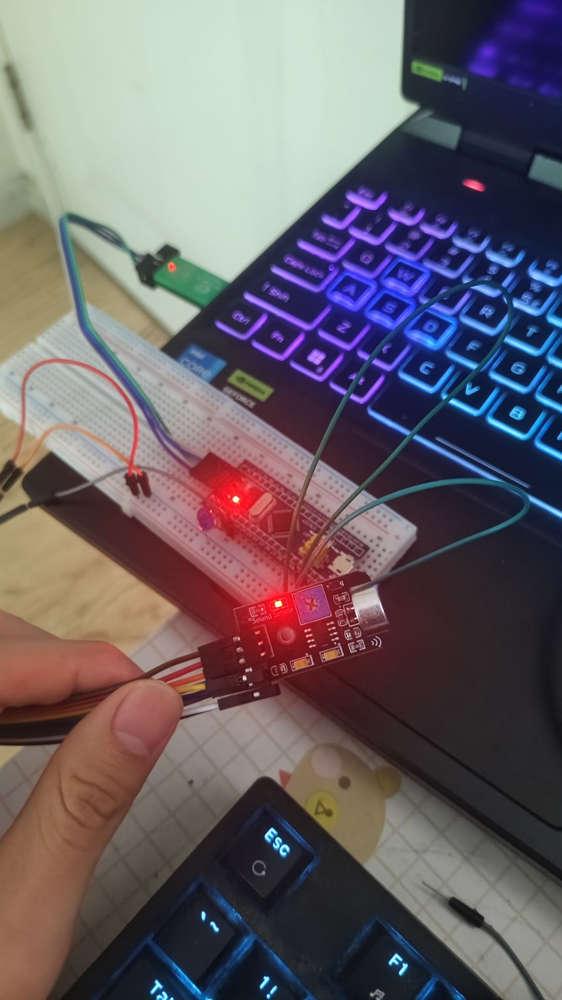

说话时亮灯：
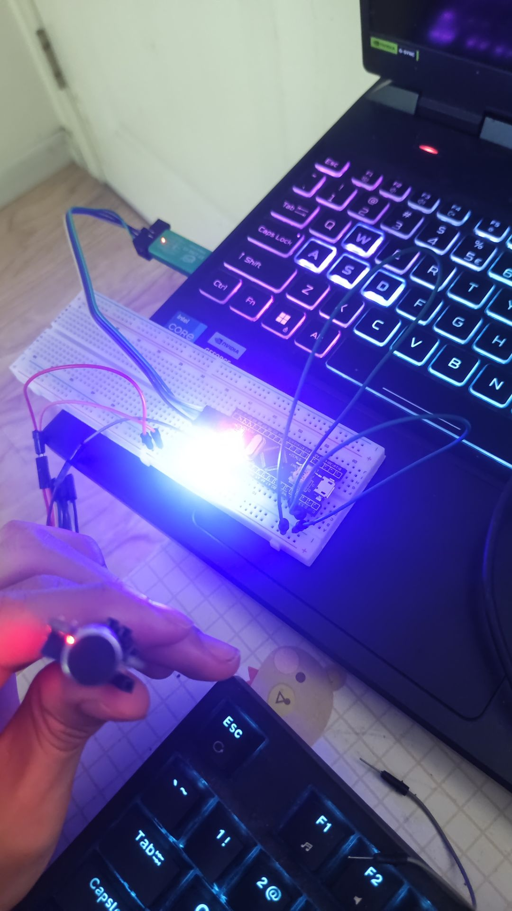

记录了不同环境下的数值范围，为后续算法优化提供依据  

三.遇到的主要问题:  

1.刚开始我使用的低电平点亮led灯，结果出现初始时常亮，对着麦克风说话是闪灭闪灭的状态，即使我反复确认了我的led.c的代码初始时设置的状态确实是使PA0口设置为高电平，在询问ai后才知道这是我的硬件接线逻辑认知偏差，主观认为 LED 低电平点亮，但实际接线为STM32 PA0 → LED长脚（正极） → LED短脚（负极） → GND，该接线天然是高电平点亮（PA0 输出 3.3V 时 LED 形成电压差点亮，0V 时熄灭），与代码中 “低电平点亮” 的逻辑完全反向，直接导致 LED 初始常亮。

2.刚开始 ADC 读数一直为 0 ,检查后发现是 GPIO 模式未配置为模拟输入  

3.说话小声时灯不会亮，应该是阈值过大的问题，但又不知道阈值具体该调多少

四.当前进度：  

声控基础功能已跑通  

下一步：通过串口助手调试阈值


2026年3月19日~3月20日:串口调试与阈值基本校准完成

一.任务背景

在完成基础声控功能后，为进一步提高系统稳定性并找到最优触发阈值，通过串口打印 ADC 值进行定量测试。

代码实现：
```c
//主函数main
#include "stm32f10x.h"
#include "Delay.h"
#include "AD.h"
#include "LED.h"
#include "Serial.h"     // 江协科技的串口库

// ========== 调试开关 ==========
// 1 = 开启串口打印（调试用）
// 0 = 关闭串口打印（正常用）
#define DEBUG_ENABLE  0

int main(void)
{
    LED_Init();          // PA0 高电平点亮
    AD_Init();           // PA1 ADC 输入

#if DEBUG_ENABLE
    Serial_Init();       // 初始化串口
    Serial_SendString("Start\r\n");
#endif

    uint16_t adc_value;
    uint16_t threshold = 100;  
    uint8_t stable_cnt = 0;

    while(1)
    {
        // 1. 读取 ADC
        adc_value = AD_GetValue();

        // 2. 声控逻辑
        if(adc_value > threshold)
        {
            stable_cnt++;
            if(stable_cnt >= 3)
            {
                LED_ON();
                stable_cnt = 3;
            }
        }
        else
        {
            if(stable_cnt > 0) stable_cnt--;
            if(stable_cnt == 0)
            {
                LED_OFF();
            }
        }

        // 3. 调试打印
#if DEBUG_ENABLE
        static uint32_t cnt = 0;
        if(++cnt >= 40)          // 每 40 次循环打印一次（约 2 秒）
        {
          
            Serial_Printf("ADC=%d\r\n", adc_value);
            cnt = 0;
        }
#endif

        // 4. 延时
        Delay_ms(50);
    }
}
```
硬件连接: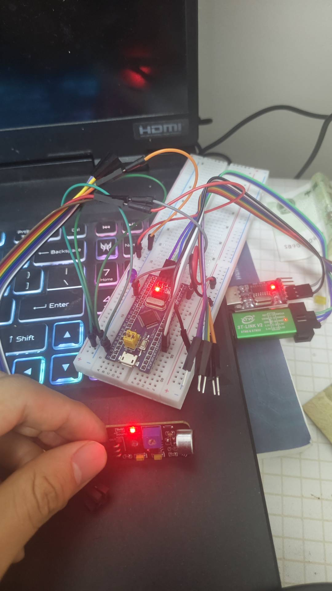

二.调试目标
1.测量不同环境下的 ADC 数值范围  
2.计算并验证最佳触发阈值  
3.确保灯在说话时可靠点亮，安静时不误触发

三.测试数据记录
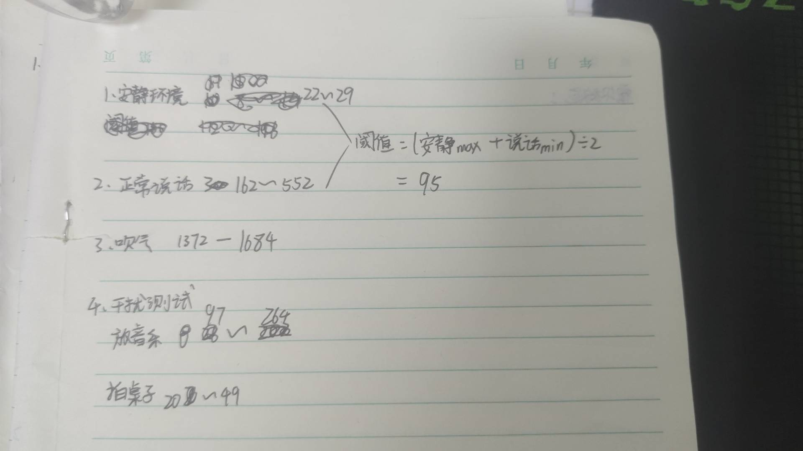
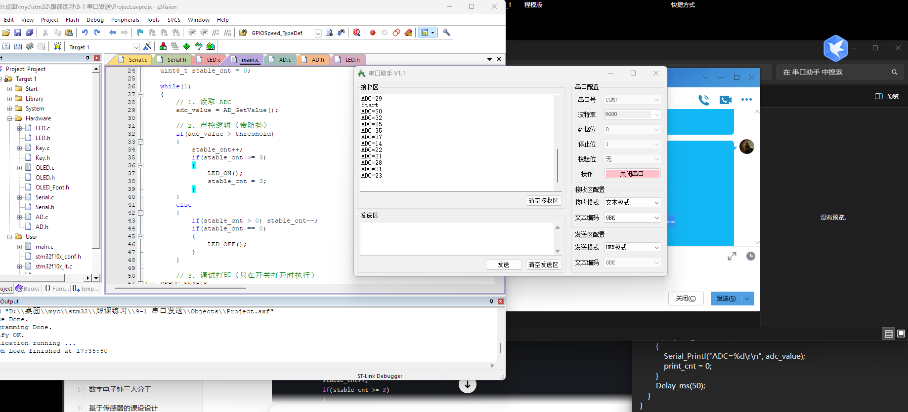
四.得出最佳阈值
采用公式：  
`阈值 = (安静最大值 + 说话最小值) ÷ 2`  
代入数据：  
`(29 + 162) ÷ 2 ≈ 95`
最终阈值我将其设定为100

五.问题梳理

最初尝试使用标准库直接配置USART，通过 printf打印数据，结果我发现下载到芯片后，LED 不响应，串口无数据，这一点我苦恼很久都没找出原因

我通过分析发现，直接使用 printf 时，它会阻塞等待串口发送完成

因为 printf 底层每发一个字节都要等待硬件标志位，而我的主循环里又频繁调用它，导致 LED 控制代码长时间得不到执行，灯自然不亮

于是我决定尝试通过计数器控制 printf每 2 秒执行一次，减少占用时间  

不过现象是：卡死情况有所缓解，但灯仍会出现短暂无响应

而且接踵而至的问题是我压根无法在串口助手上接收到adc的值，再次让我苦恼了很久，这个时候就连询问ai多次尝试后也无法给我解决这个问题

于是我从另一个方向找突破口，毕竟我是在学习中的小白，我去b站看江协科技的视频，发现他使用了一套封装好的Serial.c/Serial.h库。 

我直接移植到项目中，并尝试用#define DEBUG_ENABLE控制打印开关，正常运行时关闭打印，调试时才打开，即使调试时，也保持低频打印（每 2 秒一次）

为解决调试阻塞问题，改用经过验证的 Serial.c / Serial.h 库（江协科技视频配套代码）  

该库已包含稳定的串口初始化、字节发送、字符串发送及 printf 重定向实现。

修改后现象：

1.串口正常输出 Start 及 ADC=xxx

2.LED 响应正常，未出现卡死

3.调试与主功能互不干扰

于是我总结了经验：
在 STM32 调试初期，使用稳定可靠的现成库可大幅减少低级错误，将精力集中在业务逻辑上

调试代码应通过条件编译与主功能解耦，避免影响实时性  

高频调用阻塞函数是嵌入式开发的常见陷阱

不过也有其他问题出现：环境噪音导致误触发,决定下一步引入软件滤波

六.明日计划：学习移动平均滤波，提升系统稳定性

2026年3月20日~21日:移动平均滤波实现与串口双打印调试

一.任务目标：  

1.在 ADC 采样基础上增加移动平均滤波，降低数值抖动  

2.通过串口同时打印原始值（Raw）与滤波值（Filt），对比滤波效果  

3.验证滤波对声控灯稳定性的提升

二.具体我是怎么做的

实现滤波函数，在 AD.c 中添加 AD_GetFiltered(void)，采用长度为 10 的滑动窗口平均：
```c
   #define FILTER_LEN 10

   uint16_t AD_GetFiltered(void) {
       static uint16_t buffer[FILTER_LEN] = {0};
       static uint8_t index = 0;
       uint32_t sum = 0;

       buffer[index] = AD_GetValue();
       index = (index + 1) % FILTER_LEN;

       for (int i = 0; i < FILTER_LEN; i++) {
           sum += buffer[i];
       }
       return sum / FILTER_LEN;
   }
```

我修改了主循环，同时打印原始值与滤波值，在 main.c 中调用两个函数，并通过串口每 2 秒打印一次数据：
   
   ```c
   raw = AD_GetValue();
   filt = AD_GetFiltered();
   
   static uint32_t cnt = 0;
   if (++cnt >= 40) {
       char buf[40];
       sprintf(buf, "Raw:%4d Filt:%4d\r\n", raw, filt);
       Serial_SendString(buf);
       cnt = 0;
   }
   ```

这样用滤波值控制 LED 并观察效果，并将阈值判断从原始值切换为滤波值，对比前后稳定性。

三.调试数据记录
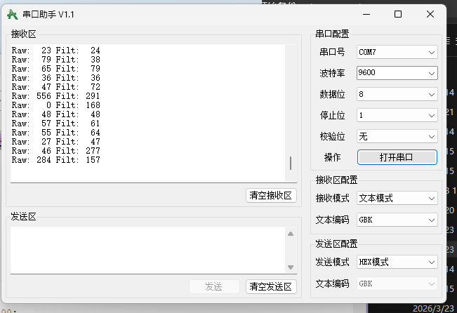
硬件图：


安静 20至30 ，20至30 两者接近，无触发 

说话 150至550 ，250至350 Filt 平滑上升，触发稳定 

声音突停 0 ，150至200 Filt 缓慢下降，存在滞后 

四.遇到的问题与解决
我发现在加入滤波后响应变慢，声音停止后灯延迟熄灭

我也在想会不会又是声明代码原因会导致滞后呢，不过灯又是正常亮灭，没办法我只能向ai询问，他给我的答复是窗口长度 10 在平滑噪声的同时也引入了滞后

所以果不其然是ad代码那个AD_GetFiltered()的循环导致滞后了，于是我决定改用原始值快速触发 + 滤波值稳态熄灭的双阈值策略，平衡响应速度与稳定性

五.最终效果
安静时：Filt 稳定在 30 以下，灯不亮 

说话时：Raw 迅速超过触发阈值，灯立即亮 

声音停止后：Filt 缓慢下降，待低于熄灭阈值后灯才灭，避免频繁闪烁 

代码实现：
```c
//主函数main
#include "stm32f10x.h"
#include "Delay.h"
#include "AD.h"
#include "LED.h"
#include "Serial.h"     // 江协科技的串口库

#define DEBUG_ENABLE  0   // 调试时改为 1

int main(void)
{
    LED_Init();
    AD_Init();

#if DEBUG_ENABLE
    Serial_Init();
    Serial_SendString("Start\r\n");
#endif

    uint16_t raw, filt;
    uint16_t threshold_on = 150;   // 亮灯阈值（原始值）
    uint16_t threshold_off = 80;   // 灭灯阈值（滤波值）
    uint8_t led_state = 0;         // 0:灭, 1:亮

    while(1)
    {
        raw = AD_GetValue();
        filt = AD_GetFiltered();

        // 亮灯条件：原始值超过高阈值
        if (raw > threshold_on) {
            led_state = 1;
        }
        // 灭灯条件：滤波值低于低阈值
        else if (filt < threshold_off) {
            led_state = 0;
        }

        // 更新 LED
        if (led_state) {
            LED_ON();
        } else {
            LED_OFF();
        }

#if DEBUG_ENABLE
        static uint32_t cnt = 0;
        if (++cnt >= 40) {
            char buf[40];
            sprintf(buf, "Raw:%4d Filt:%4d State:%d\r\n", raw, filt, led_state);
            Serial_SendString(buf);
            cnt = 0;
        }
#endif

        Delay_ms(50);
    }
}

```
下一步计划
微调双阈值参数，适应实际使用环境

整理项目文档，录制演示视频，准备简历投递

2026年3月23日~24日: 防抖机制实现与参数调优

一.任务目标

1. 解决拍桌子等短时冲击导致的误触发问题(这在之前实现普通声控灯时用过，但是被我用双阈值的方法给代替了，实测时发现单拍桌子的时候灯会微微闪一下，所以考虑到稳定性还是使用防抖计数器)
   
2. 引入计数防抖，让灯只有在声音持续一段时间后才响应
 
3. 调优双阈值参数，平衡响应速度与抗干扰能力

二.具体我是怎么做的

1. 在 main.c 中加入防抖计数器

```c
uint8_t stable_cnt = 0;   // 防抖计数器

if (raw > threshold_on) {
    stable_cnt++;
    if (stable_cnt >= 3) {
        led_state = 1;
        stable_cnt = 3;
    }
}
else if (filt < threshold_off) {
    if (stable_cnt > 0) stable_cnt--;
    if (stable_cnt == 0) {
        led_state = 0;
    }
}
```

原理：

声音必须连续 3 次超过阈值才亮灯

声音必须连续 3 次低于阈值才灭灯

单次噪声（如拍桌子）只会让 stable_cnt 加 1，达不到 3，不会触发

2. 调优双阈值参数

亮灯阈值 threshold_on：使用原始值 raw，保证快速响应

灭灯阈值 threshold_off：使用滤波值 filt，保证平稳熄灭

最终定参：threshold_on = 150，threshold_off = 80

3. 测试不同场景


三.调试数据记录

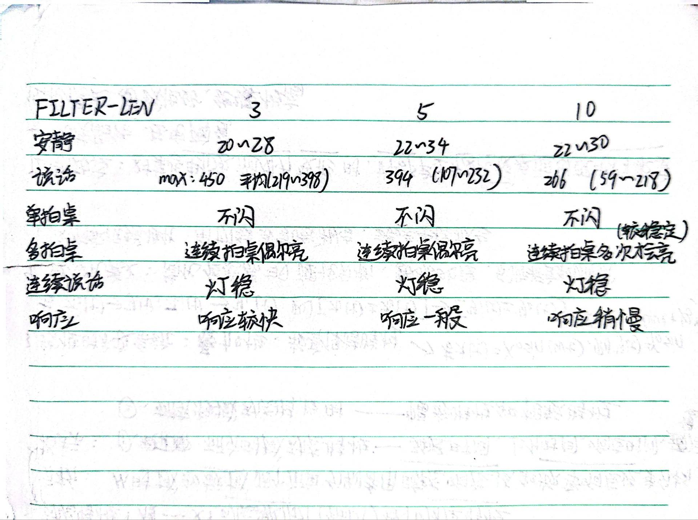

 最终选择将FILTER_LEN设为 10
---

四.遇到的问题与解决

问题：拍桌子时灯还是会亮

原因：单次拍桌子的音量峰值和说话差不多，单纯靠阈值无法区分

解决：引入计数防抖，连续 3 次触发才亮灯，单次冲击不会累积到 3

问题：连续快速拍桌子还是会亮

分析：连续拍在物理上等同于持续声音，系统判断为有效触发，属于正常现象，不做特殊处理

五.最终效果

说话时灯立即亮，，安静时灯稳定灭，拍一下桌子不会误触发，灯不会因环境噪声频繁闪烁

2026年3月25日~26日: 自适应阈值实现与项目收尾

一、任务目标

1. 让系统能自动适应不同环境音量，避免手动调参（考虑到一个设备要到不同环境下工作） 
2. 完成项目收尾，准备展示材料

二、具体我是怎么做的

加入自适应阈值

在 main 函数初始化阶段，先采样 20 次滤波值，取平均作为环境底噪：

```c
uint16_t base_noise = 0;
for (int i = 0; i < 20; i++) {
    base_noise += AD_GetFiltered();
    Delay_ms(10);
}
base_noise /= 20;
threshold_on = base_noise * 2 + 50;
threshold_off = base_noise + 20;
```

同时每隔 30 秒重新校准一次：

```c
static uint32_t adapt_timer = 0;
if (++adapt_timer >= 600) {   // 30秒 = 600 * 50ms
    // 重新采样环境底噪，更新阈值
    adapt_timer = 0;
}
```

效果：系统能自动适应安静房间和嘈杂环境，无需手动改代码

三.项目收尾

经过多轮测试与调优，确定以下最终方案：

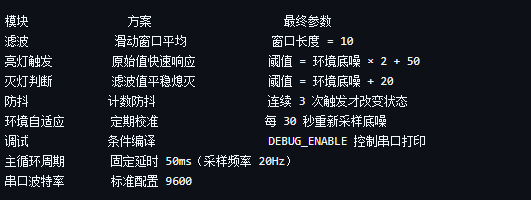


核心代码说明

1. 滑动平均滤波

```c
#define FILTER_LEN 10

uint16_t AD_GetFiltered(void) {
    static uint16_t buffer[FILTER_LEN] = {0};
    static uint8_t index = 0;
    uint32_t sum = 0;

    buffer[index] = AD_GetValue();
    index = (index + 1) % FILTER_LEN;

    for (int i = 0; i < FILTER_LEN; i++) sum += buffer[i];
    return sum / FILTER_LEN;
}
```

2. 双阈值防抖逻辑

```c
if (raw > threshold_on) {
    stable_cnt++;
    if (stable_cnt >= 3) {
        led_state = 1;
        stable_cnt = 3;
    }
}
else if (filt < threshold_off) {
    if (stable_cnt > 0) stable_cnt--;
    if (stable_cnt == 0) {
        led_state = 0;
    }
}
```

3. 自适应阈值

```c
// 初始化：采样 20 次取平均
uint16_t base_noise = 0;
for (int i = 0; i < 20; i++) {
    base_noise += AD_GetFiltered();
    Delay_ms(10);
}
base_noise /= 20;
threshold_on = base_noise * 2 + 50;
threshold_off = base_noise + 20;

// 每 30 秒重新校准
static uint32_t adapt_timer = 0;
if (++adapt_timer >= 600) {
    // 重新采样，更新阈值
    adapt_timer = 0;
}
```

4. 条件编译控制调试

```c
#define DEBUG_ENABLE 0   // 调试时改为 1

#if DEBUG_ENABLE
    Serial_Init();
    // 打印 Raw、Filt、State 等
#endif
```

---

测试数据记录

测试项 窗口长度 3 窗口长度 5 窗口长度 10

安静时 Filt 20~28 22~34 22~30

说话时峰值 450 394 266

拍桌子误触发 会 偶尔 基本不

灯稳定性 偶尔闪 基本不闪 稳定

最终选择：窗口长度 10

最终效果
响应速度：说话后约 150ms 亮灯（3 × 50ms）

抗干扰：拍桌子不会误触发，连续拍会亮（物理正常）

环境自适应：安静房间和嘈杂环境都能稳定工作

可调试：串口打印可开关，不影响正常使用

代码结构：模块化清晰，便于后续扩展


四.项目总结

从 3 月 8 日启动到 3 月 26 日收尾，历时 19 天，完成了：

· 硬件接线与调试
· ADC 采集与滑动滤波
· 双阈值防抖逻辑
· 自适应环境校准
· 串口调试与条件编译
· 完整项目文档

五.后续准备扩展方向

加 OLED 显示当前音量

用 PWM 实现声音越大灯越亮

增加蓝牙模块，手机控制阈值

移植到 RTOS，学习多任务调度


视频展示：哔哩哔哩https://b23.tv/UO9EE2F

如何运行我的项目

硬件连接：按照原理图连接STM32、麦克风模块和LED。

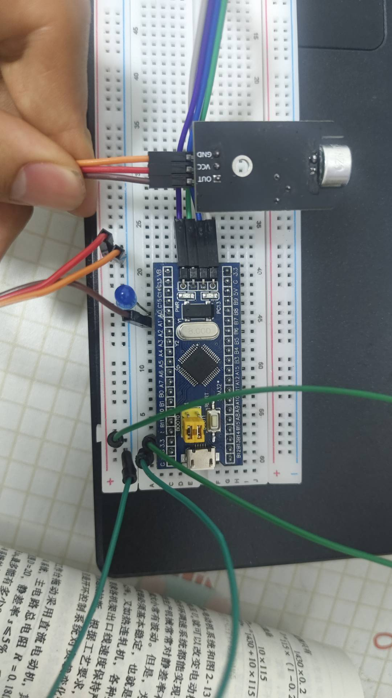

软件准备：使用Keil MDK打开工程文件。

编译下载：连接USB线，编译代码并下载到单片机。
